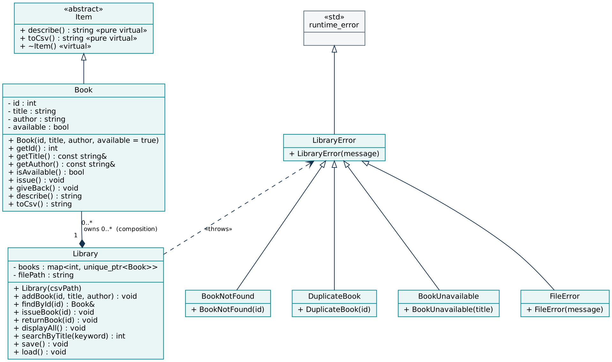
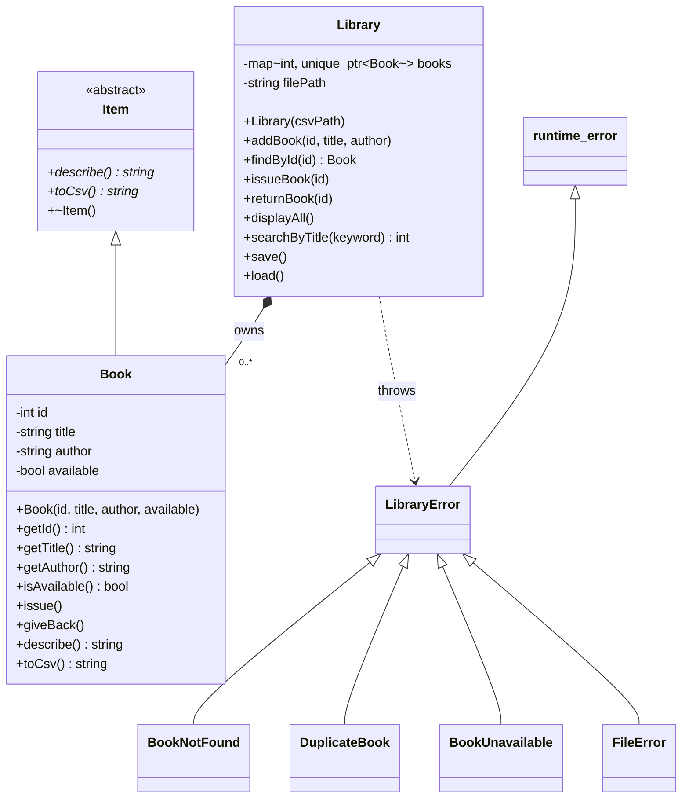

# Library Management System (C++)

Practical 12 - individual mini project for the C++ Programming Practical Manual.
Author: **Puneet Kumar** | Roll No: E25B000036 | Division: D | Academic year: 2026

## Project description

A console-based application that lets a librarian keep a catalogue of books, search it, and issue and
return books. Every change is saved to a CSV file, and the records are loaded automatically the next
time the program starts.

## Problem statement

Tracking which books exist and which are currently issued on paper is slow and error-prone: IDs get
duplicated, issued books are handed out twice, and records are lost when a register is damaged. This
program stores the catalogue in a CSV file and enforces these rules automatically.

## Objectives

- Apply the course concepts in one small, complete program: OOP, STL, exceptions and file I/O.
- Prevent invalid operations (duplicate IDs, unknown IDs, issuing an issued book, returning a book that was not issued).
- Keep data safe between runs using a CSV file, even when the file is missing or damaged.
- Keep the design simple enough to explain every part in a viva.

## Features

| # | Menu option | What it does |
|---|-------------|--------------|
| 1 | Add book | Adds a book (ID, title, author). Duplicate IDs are rejected. |
| 2 | Display all books | Lists every book, sorted by ID, with its status (Available / Issued). |
| 3 | Search by ID | Shows one book or reports "not found". |
| 4 | Search by title | Case-insensitive partial match on the title. |
| 5 | Issue book | Marks an available book as issued; refuses unknown or already-issued books. |
| 6 | Return book | Marks an issued book as available; refuses unknown books or books that were not issued. |
| 7 | Exit | Leaves the program. |

Records are saved automatically after every successful add / issue / return.

## Technologies used

- C++17 (g++), standard library only - no external dependencies
- `std::filesystem` (to create the data folder if needed)
- Valgrind (memory check), Graphviz (UML diagram), Bash (test script)

## OOP concepts implemented

| Concept | Where |
|---------|-------|
| Encapsulation | `Book` keeps `id`, `title`, `author`, `available` private; the status changes only through `issue()` / `giveBack()`. `Library` keeps its `map` private. |
| Constructors | `Book(id, title, author, available = true)`, `Library(csvPath)`, and exception constructors. |
| Inheritance + polymorphism | `Book` inherits from the abstract class `Item`, which declares the pure virtual functions `describe()` and `toCsv()` and a virtual destructor. Exceptions also form an inheritance hierarchy. |
| Resource management (RAII) | Books are owned by `unique_ptr` (no `new`/`delete`); files are `ifstream`/`ofstream` objects that close themselves. |

## STL usage

- `std::map<int, std::unique_ptr<Book>>` - stores the books, sorted by ID, with fast lookup and duplicate detection (`count`, `find`).
- `std::string`, `std::stringstream` - parsing CSV lines and building text.
- `std::transform`, `std::all_of` - case-insensitive search and input validation.

## Exception handling

All library-specific errors derive from `LibraryError` (which derives from `std::runtime_error`):

| Exception | Thrown when |
|-----------|-------------|
| `BookNotFound` | An ID does not exist (search, issue, return). |
| `DuplicateBook` | Adding an ID that already exists (also when loading a CSV with repeated IDs). |
| `BookUnavailable` | Issuing a book that is already issued. |
| `FileError` | The CSV file cannot be opened or written. |
| `LibraryError` | Returning a book that was not issued, and invalid user input (bad number, empty or comma-containing text). |

`main()` catches `LibraryError` inside the menu loop, prints the message and continues, so one bad entry never crashes the program.

## File handling

- Format: `id,title,author,available` with a header line; `available` is `1` or `0`. See [`data/books.csv`](data/books.csv).
- Loaded automatically at start-up. A **missing file** starts an empty library (and is created on the first save); an **unreadable file** gives a warning; **malformed lines**, bad IDs, bad flags and duplicate IDs are skipped and reported.
- Saving creates the `data/` folder if needed. If the file cannot be written, a warning is printed and the program keeps running.
- Titles and authors may not contain commas (so the simple CSV format stays unambiguous).

## Project structure

```text
Practical-12-Library-Management-System/
├── src/library.cpp              source code (single file, easy to explain)
├── data/books.csv               sample data, also the default storage file
├── docs/
│   ├── uml-class-diagram.png    UML diagram (also .svg and the .dot source)
│   ├── sample-console-output.txt  full demo session
│   ├── test-transcripts/        real transcript of every automated test
│   ├── valgrind-report.txt      memory check of the demo session
│   └── books-after-demo.csv     CSV saved after the demo session
├── screenshots/                 see its README
├── run_tests.sh                 automated tests
└── README.md
```

## UML class diagram



The same diagram in Mermaid (renders on GitHub):



## Compilation instructions

From the repository root:

```bash
g++ -std=c++17 -Wall -Wextra -Wpedantic -o build/library Practical-12-Library-Management-System/src/library.cpp
```

(Create the folder first with `mkdir -p build` if it does not exist.)

## Execution instructions

Run the program from the `Practical-12-Library-Management-System` folder so the default path `data/books.csv` is found:

```bash
cd Practical-12-Library-Management-System
../build/library                 # uses data/books.csv
../build/library my_books.csv    # optional: use another CSV file
```

> Running the program changes `data/books.csv` (it is the live data file). Restore the original sample with `git checkout data/books.csv`.

## Sample usage

```text
Name: Puneet Kumar
Loaded 5 book(s) from data/books.csv
Choice: 5
Book ID to issue: 101
Book issued.
Choice: 5
Book ID to issue: 101
ERROR: 'Let Us C++' is already issued
```

The complete session is in [`docs/sample-console-output.txt`](docs/sample-console-output.txt).

## Sample test cases

Run all tests with `./run_tests.sh` (from this folder). Each test feeds scripted input to the real program, saves the real transcript in [`docs/test-transcripts/`](docs/test-transcripts/) and checks the output and the CSV file. Latest run: **37 checks passed, 0 failed.**

| Test | Scenario | Expected result | Transcript |
|------|----------|-----------------|------------|
| T01 | Add a new book | "Book added." and the book is in the CSV | [T01](docs/test-transcripts/T01_add_book.txt) |
| T02 | Display all books | All books listed with status and total | [T02](docs/test-transcripts/T02_display_all.txt) |
| T03 | Search existing book (ID and title) | Book shown | [T03](docs/test-transcripts/T03_search_existing.txt) |
| T04 | Search nonexistent book | "Book ID 999 not found" / "No book found" | [T04](docs/test-transcripts/T04_search_missing.txt) |
| T05 | Issue an available book | Status becomes Issued and is saved | [T05](docs/test-transcripts/T05_issue_available.txt) |
| T06 | Issue an already-issued book | Error, nothing changes | [T06](docs/test-transcripts/T06_issue_already_issued.txt) |
| T07 | Return a book | Status becomes Available and is saved | [T07](docs/test-transcripts/T07_return_book.txt) |
| T08 | Return a book that was never issued | Error "was not issued" | [T08](docs/test-transcripts/T08_return_not_issued.txt) |
| T09 | Add a duplicate ID | Error, original book kept | [T09](docs/test-transcripts/T09_duplicate_id.txt) |
| T10 | Restart and reload | New book and its issued status are loaded | [T10a](docs/test-transcripts/T10a_first_run.txt), [T10b](docs/test-transcripts/T10b_after_restart.txt) |
| T11 | Invalid input (letters, negative, zero, empty, comma) | Clear error, nothing added | [T11](docs/test-transcripts/T11_invalid_input.txt) |
| T12 | Missing data file | Starts empty; file created on first save | [T12](docs/test-transcripts/T12_missing_file.txt) |
| T13 | Malformed CSV lines | Bad lines skipped, good ones loaded | [T13](docs/test-transcripts/T13_malformed_csv.txt) |
| T14 | File that cannot be written | Warning, program keeps running | [T14](docs/test-transcripts/T14_unwritable.txt) |
| T15 | End of input | Clean exit | [T15](docs/test-transcripts/T15_eof.txt) |

Memory check: Valgrind on the demo session reports all heap blocks freed and 0 errors ([`docs/valgrind-report.txt`](docs/valgrind-report.txt)).

## Limitations and future improvements

- Search by title only (no author search); the ID search is exact.
- Titles and authors cannot contain commas (a quoted-CSV parser would remove this limit).
- Issuing does not record *who* borrowed the book or a due date. A `Member` class and a fine calculator would be natural extensions.
- Book IDs are entered manually; they could be generated automatically.
- Single-user, single-file storage; no concurrent access or database.
- Unit tests are script-based; a framework such as Catch2 or GoogleTest could be added.
